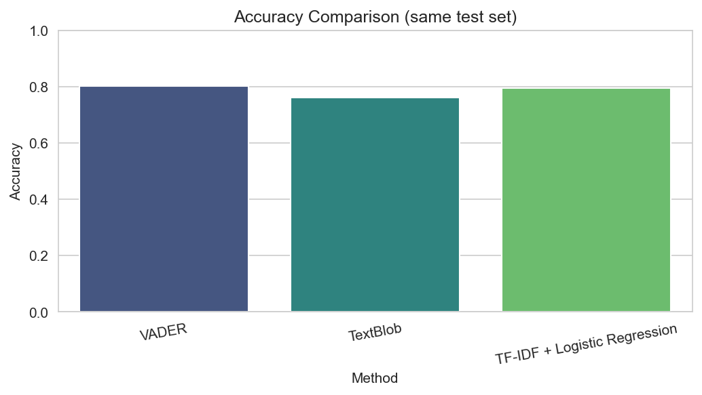
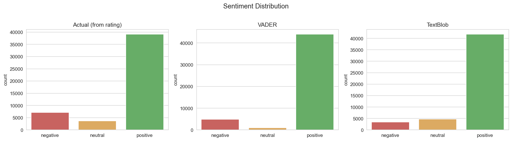
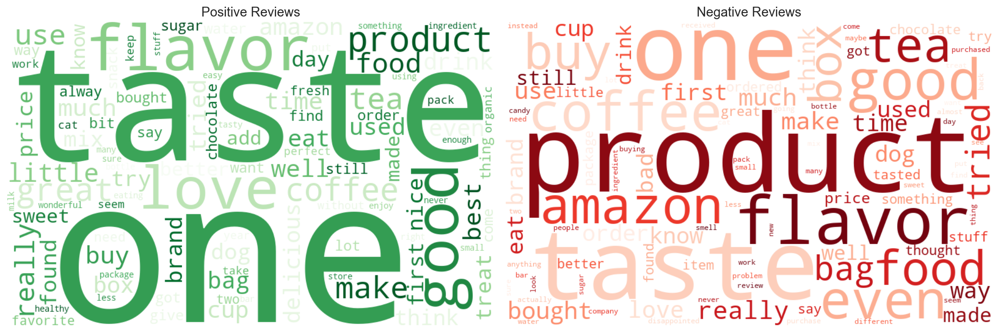

# Sentiment Analysis on Amazon Reviews

Classifies Amazon food reviews as **positive, negative or neutral** using NLP techniques and sentiment lexicons, and derives insights useful for marketing and product development.

## Dataset
[Amazon Fine Food Reviews](https://www.kaggle.com/datasets/snap/amazon-fine-food-reviews) (Kaggle). A random sample of 50,000 reviews is used.
Star ratings are mapped to labels: 4-5 = positive, 3 = neutral, 1-2 = negative.

The full dataset is not included in this repo because of its size.

## Approach
1. Data cleaning and sampling
2. Text preprocessing: lowercasing, HTML/URL/punctuation removal, stopword removal (negations kept), lemmatization
3. Lexicon-based sentiment with **VADER** and **TextBlob**
4. Comparison of lexicon labels against actual star ratings
5. Supervised model: **TF-IDF + Logistic Regression** (class-balanced)
6. Visualizations: sentiment distribution, confusion matrices, word clouds, top indicator words, review length
7. Business insights

## Results
Accuracy on the same held-out test set (10,000 reviews):

| Method | Accuracy |
|---|---|
| VADER | 80.12% |
| TextBlob | 76.10% |
| TF-IDF + Logistic Regression | 79.42% |

Per-class recall (how many reviews of each class are found):

| Class | VADER* | TextBlob* | Logistic Regression |
|---|---|---|---|
| Negative | 41% | 29% | 72% |
| Neutral | 4% | 16% | 42% |
| Positive | 95% | 91% | 84% |

\*Lexicon recall is computed on the full 50,000-review sample.





## Key Findings
- The dataset is heavily skewed: about 78% of reviews are positive, 14% negative and 7% neutral.
- VADER has the highest overall accuracy (80.1%), but mostly because it labels almost everything positive. It finds only about 41% of negative and 4% of neutral reviews.
- The Logistic Regression model is slightly lower in accuracy (79.4%) but much more balanced: it recovers 72% of negative and 42% of neutral reviews, and its macro F1 (0.62) is well above both lexicons (about 0.48).
- Many negative and neutral reviews contain positive words (for example "good", "like"), so lexicons tend to label them positive. Negation phrases such as "not good" and "not recommend" are among the strongest negative indicators learned by the model.
- Average VADER score rises steadily with star rating, from 0.03 for 1-star to 0.79 for 5-star reviews.
- Top positive words: great, delicious, best, love, perfect, excellent. Top negative words: not recommend, terrible, worst, disappointed, awful, not good.
- Negative and neutral reviews are longer (median 62 and 69 words) than positive ones (55 words), so unhappy customers tend to write more.

## Business Insights
- **Marketing:** customers praise taste and quality (delicious, great, perfect), which is what product descriptions and ads should highlight.
- **Product development:** negative reviews mention disappointment, returns and poor quality; flagging them automatically can help support and quality teams respond faster.
- **Monitoring:** the pipeline can be run on new reviews to track sentiment over time.

## Limitations
- Star rating is used as ground truth, but rating and text do not always agree.
- Only a 50,000-review sample is used, and only English food reviews.
- Neutral (3-star) reviews are hard for every method.

## How to run
```bash
pip install kagglehub nltk textblob vaderSentiment wordcloud scikit-learn seaborn matplotlib pandas
python sentiment_analysis.py
```
Download `Reviews.csv` from Kaggle and place it next to the script (the script tries `kagglehub` if the file is missing). Charts are saved as PNG files and predictions in `sentiment_results.csv`.

## Tech stack
Python, pandas, NLTK, VADER, TextBlob, scikit-learn, matplotlib, seaborn, WordCloud
